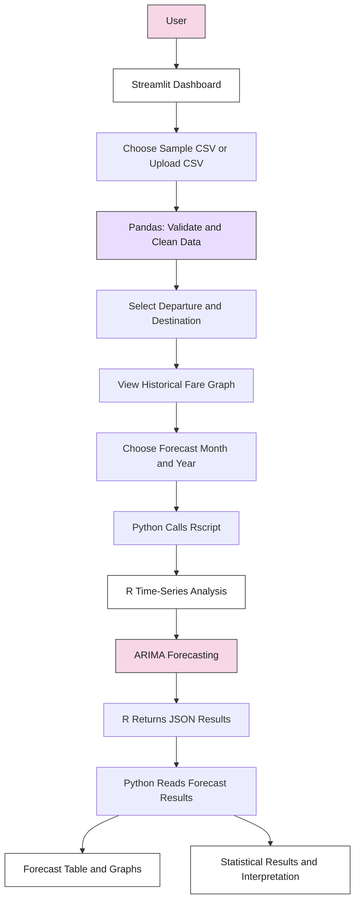
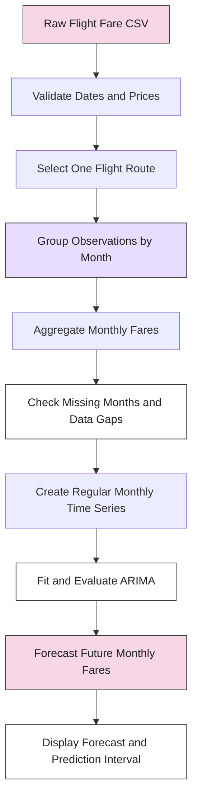

# Flight Fare Forecaster

A time-series forecasting application built using Python, Streamlit, R, and ARIMA to estimate future monthly flight fares using historical flight-price data.

The application allows users to explore historical fares, select a departure and destination, choose a future month, and generate a forecast with an estimated prediction interval. It also displays interactive graphs, statistical information, and an automatic interpretation of the results.

---

## 1. Project Overview

Imagine you want to travel from Mumbai to Delhi in six months. You want to understand whether flight fares might increase, decrease, or remain relatively stable.

The Flight Fare Forecaster uses historical flight-price data to study past patterns and estimate what fares might look like in a selected future month.

Instead of manually comparing months of historical prices, users can upload their own dataset or use the provided sample dataset and generate forecasts through an interactive dashboard.

| Project detail | Description |
|---|---|
| Project name | Flight Fare Forecaster |
| Project type | Time-Series Analysis and Forecasting |
| Programming languages | Python and R |
| User interface | Streamlit |
| Data processing | Pandas |
| Visualizations | Plotly |
| Forecasting method | ARIMA |
| Statistical testing | Augmented Dickey-Fuller (ADF), as reported by the R analysis |
| Input format | CSV |
| Output | Predicted fares, prediction intervals, tables, graphs, and statistical information |
| Currency displayed | Indian Rupees (₹) |
| Main objective | Estimate future flight fares using historical price patterns |

Important: The application provides statistical estimates, not guaranteed ticket prices. Actual airline fares may change because of demand, seasonality, fuel prices, seat availability, airline decisions, and other factors.

## 2. Problem Statement

Flight prices can change considerably over time. Travelers may find it difficult to decide when to book tickets because they do not know how prices might change in the future.

Historical price data can help identify trends, but manually studying large datasets is time-consuming.

This project addresses the problem by creating an interactive forecasting dashboard that:

- Organizes historical flight-price data.
- Allows users to select a specific flight route.
- Displays historical fare patterns.
- Applies time-series analysis using R.
- Estimates fares for a selected future month.
- Shows prediction intervals to communicate uncertainty.
- Provides statistical information and a simple interpretation of the results.

## 3. Main Features

| Feature | Description |
|---|---|
| Sample dataset | Loads a CSV file from `data/sample_flight_prices.csv`. |
| Custom dataset upload | Allows users to upload their own CSV file. |
| Data validation | Checks for required columns and removes invalid observations. |
| Dataset preview | Displays the first 10 valid records and basic dataset statistics. |
| Route selection | Lets users select a departure location and destination. |
| Historical fare graph | Displays past average fares for the selected route. |
| Future month selection | Allows users to choose a forecast year and month. |
| ARIMA forecasting | Calls an R script to generate time-series forecasts. |
| 80% prediction interval | Displays lower and upper forecast bounds supplied by the R script. |
| Forecast table | Shows monthly forecast values and prediction bounds. |
| Historical and forecast graph | Combines historical fares and predicted fares in one visualization. |
| Three-month moving average | Smooths short-term fluctuations to make trends easier to observe. |
| Automatic interpretation | Classifies recent trends and predicted fare levels using simple rules. |
| Statistical information | Displays the ARIMA model, ADF p-value, stationarity status, observations, historical mean, and AIC. |
| Error handling | Reports missing files, invalid data, and R execution errors. |
| Custom background | Uses `flight.JPG` when the image is available. |

## 4. System Architecture

The application uses two programming languages, each with a different responsibility.

- Python manages the dashboard, data preparation, user inputs, and graphs.
- R performs the time-series analysis and returns forecasting results.
- Streamlit connects the user to the application's features.
- Pandas prepares the dataset, and Plotly creates interactive visualizations.

### Architecture diagram



### How the system works

1. The user opens the Streamlit application.
2. The user selects the sample dataset or uploads a CSV file.
3. Python checks the dataset, converts dates and prices into suitable formats, and removes invalid records.
4. The user selects a departure location and destination.
5. The application displays historical prices for that route.
6. The user selects a future month and year.
7. Python calculates how many months ahead the forecast must extend.
8. Python launches the R script using `subprocess`.
9. R performs the time-series analysis and returns the results in JSON format.
10. Python displays the predicted fares, prediction intervals, tables, graphs, and statistical interpretation.

The R script is an essential part of the system. The Python code expects it to return specific results in a format that can be converted into JSON.

## 5. What Is the Input?

The application accepts historical flight-price information from either a sample CSV file or a user-uploaded CSV file.

### Input options

| Input | Description | Example |
|---|---|---|
| Dataset source | Select the sample dataset or upload a file | Sample Dataset |
| Date | Date associated with a fare observation | `2025-01-01` |
| Origin | Departure location | `Mumbai` |
| Destination | Arrival location | `Delhi` |
| Average_Price | Historical average fare | `4500` |
| Forecast year | Year for the requested prediction | `2027` |
| Forecast month | Month for the requested prediction | `June` |

The examples above are illustrative. The actual dataset may contain different locations, dates, and prices.

### Required CSV format

The CSV must contain these four columns with the exact names shown below:

| Column | Required? | Meaning | Example |
|---|---|---|---|
| `Date` | Yes | Date of the fare observation | `2025-01-01` |
| `Origin` | Yes | Departure airport or location | `Mumbai` |
| `Destination` | Yes | Arrival airport or location | `Delhi` |
| `Average_Price` | Yes | Average fare recorded for that observation | `4500` |

### Example CSV

```csv
Date,Origin,Destination,Average_Price
2024-01-01,Mumbai,Delhi,4200
2024-02-01,Mumbai,Delhi,4500
2024-03-01,Mumbai,Delhi,4400
2024-04-01,Mumbai,Delhi,4800
2024-05-01,Mumbai,Delhi,5100
2024-06-01,Mumbai,Delhi,4950
2024-01-01,Delhi,Bengaluru,5200
2024-02-01,Delhi,Bengaluru,5400
```

These prices are sample values for demonstrating the file format, not actual flight-price records.

For meaningful forecasting, each route should have sufficient historical observations covering a reasonably consistent time interval.

### What happens to the input data?

The Python code performs several checks and cleaning operations:

1. Converts `Date` into a date format.
2. Converts `Average_Price` into a numeric value.
3. Removes extra spaces from the origin and destination names.
4. Removes records with missing or invalid dates, locations, or prices.
5. Removes records where the average price is zero or negative.
6. Sorts the records by date.

If required columns are missing or no valid records remain, the application stops and displays an error message.

Note that the current cleaning process does not aggregate multiple observations into monthly averages or verify that every month is present. This is an important consideration for time-series forecasting.

## 6. What Is the Output?

The application produces several outputs that help users understand past fare behavior and examine the model's future estimates.

| Output | What it tells the user |
|---|---|
| Dataset preview | Shows the first 10 valid records. |
| Dataset statistics | Shows the number of observations, distinct routes, and date range. |
| Historical fare graph | Shows how fares changed over time for the selected route. |
| Predicted fare | Displays the model's estimated fare for the selected future month. |
| Lower 80% bound | Displays the lower end of the model's 80% prediction interval. |
| Upper 80% bound | Displays the upper end of the model's 80% prediction interval. |
| Forecast table | Lists predicted fares and prediction bounds for each forecast month. |
| Historical + forecast graph | Shows historical observations alongside predicted values. |
| Moving average graph | Compares actual fares with a three-observation moving average. |
| Model information | Displays ARIMA model details, ADF p-value, and stationarity status. |
| Additional statistics | Displays observations used, historical mean, and AIC. |
| Automatic interpretation | Classifies the recent trend and predicted fare level. |

### Understanding the predicted fare

Suppose the application produces the following illustrative result:

| Forecast output | Example |
|---|---:|
| Predicted fare | ₹5,200 |
| Lower 80% bound | ₹4,600 |
| Upper 80% bound | ₹5,900 |

This means the model's central estimate is ₹5,200, with an estimated prediction interval ranging from ₹4,600 to ₹5,900.

The interval is not a promise that the actual ticket price will fall within those values. Its reliability depends on the model, its assumptions, and the quality of the historical data.

The example values above are for explanation only. They are not generated by the supplied code or a real dataset.

## 7. Forecasting Method: ARIMA

ARIMA stands for AutoRegressive Integrated Moving Average.

It is a statistical forecasting method that uses patterns in past observations to estimate future values.

Think of it as examining a sequence of previous prices to identify patterns that may help estimate later prices.

### The three parts of ARIMA

ARIMA is commonly written as:

`ARIMA(p, d, q)`

| Component | Full name | Simple explanation |
|---|---|---|
| `p` | AutoRegressive order | Uses previous observations to help predict the next value. |
| `d` | Differencing order | Measures changes between observations to help stabilize the series. |
| `q` | Moving Average order | Uses past forecast errors as part of the model. |

For example, an ARIMA model uses these three parameters to describe how it models the historical time series.

The exact model selected by this project depends on the implementation in `flight_forecast.R`. The supplied Python code displays the model returned by R; it does not itself select or fit the ARIMA model.

### Why use ARIMA?

- It is a well-established method for time-series forecasting.
- It can model certain trends and dependencies in historical observations.
- It provides forecasts and, when correctly implemented, prediction intervals.
- It provides statistical model information that can help with evaluation.

However, ARIMA does not automatically understand airline schedules, upcoming festivals, current seat availability, or future changes in travel demand unless those effects are explicitly incorporated into the model.

## 8. Statistical Concepts Used

The dashboard displays several statistical measures. Understanding these values helps users interpret the forecast correctly.

### A. Stationarity

A time series is stationary when important statistical properties, such as its mean and variance, remain reasonably stable over time.

In simple words, the series does not keep changing its overall statistical behavior in a way that violates the stationarity assumptions of a particular model.

The application displays a stationarity result returned by R.

### B. Augmented Dickey-Fuller (ADF) test

The ADF test is used to investigate whether a time series contains a unit root, which is associated with non-stationarity.

| ADF p-value | Common interpretation |
|---|---|
| Below 0.05 | Evidence against the unit-root null hypothesis at the 5% significance level |
| 0.05 or above | Insufficient evidence to reject the unit-root null hypothesis at the 5% significance level |

A p-value alone does not prove that a series is stationary or non-stationary in every practical sense. The result depends on the test assumptions, specification, and data.

### C. AIC

AIC stands for Akaike Information Criterion.

It helps compare statistical models by balancing goodness of fit against model complexity.

When comparing suitable models fitted to the same dataset, a lower AIC is generally preferred. AIC should not be used alone to determine whether a forecast is accurate.

### D. Historical mean

The historical mean is the average of the recorded fares for the selected route.

The application uses it as a reference when describing a predicted fare as high, moderate, or low.

### E. Three-month moving average

The moving average calculates the average of a rolling window of three consecutive observations.

For example, if the three observations are ₹4,000, ₹4,500, and ₹5,000:

\[
\text{Moving Average} =
\frac{4000+4500+5000}{3}
= ₹4,500
\]

This can make short-term fluctuations easier to observe. In the current code, the calculation is based on three rows, not necessarily three calendar months.

## 9. Automatic Interpretation

The application generates a simple written interpretation after forecasting.

It uses two comparisons.

### Recent trend

The mean of the last six fare observations is compared with the mean of all historical fare observations.

| Condition in the code | Interpretation |
|---|---|
| Recent mean is more than 5% above the historical mean | Increasing |
| Recent mean is more than 5% below the historical mean | Decreasing |
| Neither condition applies | Relatively stable |

### Predicted fare level

The forecasted fare is compared with the historical mean.

| Condition in the code | Interpretation |
|---|---|
| Predicted fare is more than 10% above the historical mean | High |
| Predicted fare is more than 10% below the historical mean | Low |
| Neither condition applies | Moderate |

These labels are rule-based descriptions, not outputs from a separate machine-learning classification model.

They also do not mean that a fare is objectively expensive or cheap in the wider market. The comparison is made only against the historical average for the selected route.

## 10. Technologies Used

| Technology | Role in the project |
|---|---|
| Python | Controls the application and manages data processing. |
| Streamlit | Creates the interactive web dashboard. |
| Pandas | Reads, cleans, filters, and organizes CSV data. |
| Plotly | Creates interactive historical, forecast, and moving average graphs. |
| R | Performs the time-series analysis through a separate script. |
| ARIMA | Estimates future values from historical time-series patterns. |
| ADF test | Provides a statistical test for a unit root. |
| JSON | Transfers the R analysis results to Python. |
| `subprocess` | Executes the R script from Python. |
| `pathlib` | Manages file and folder paths. |

## 11. Project Structure

The code expects the project to contain the following files and folders:

```text
Flight-Fare-Forecaster/
│
├── app.py
├── flight.JPG
│
├── data/
│   └── sample_flight_prices.csv
│
├── r_analysis/
│   └── flight_forecast.R
│
├── outputs/
│   └── uploaded_data.csv
│
└── requirements.txt
```

The names shown above are based on the paths in the Python code, except for the illustrative `app.py` and `requirements.txt` filenames, which should be adjusted to match the actual project.

| File or folder | Purpose |
|---|---|
| `app.py` | Example name for the main Python application. |
| `flight.JPG` | Background image used by the dashboard. |
| `data/sample_flight_prices.csv` | Sample dataset loaded by the application. |
| `r_analysis/flight_forecast.R` | R script responsible for the forecasting analysis. |
| `outputs/uploaded_data.csv` | Location where cleaned uploaded data is saved before being sent to R. |
| `requirements.txt` | Lists Python dependencies needed for installation. |

The `outputs/` folder is created automatically when a user-uploaded dataset is saved. The sample dataset, R script, and background image must be present at the expected paths for their respective features to work.

## 12. Installation and Setup

### Prerequisites

Install or prepare the following:

- Python
- R
- The Rscript executable
- A code editor such as Visual Studio Code
- The project's required Python packages
- The sample dataset and R analysis script

The provided code currently expects the Rscript executable at:

`C:\Program Files\R\R-4.6.1\bin\Rscript.exe`

If R is installed elsewhere, this path must be updated.

### Step 1: Open the project folder

Open the project folder in Visual Studio Code or a terminal.

### Step 2: Create a Python virtual environment

```bash
python -m venv venv
```

Activate it in Windows PowerShell:

```powershell
.\venv\Scripts\Activate.ps1
```

### Step 3: Install Python dependencies

If `requirements.txt` is present and contains the required dependencies, run:

```bash
pip install -r requirements.txt
```

The Python code imports Streamlit, Pandas, and Plotly. Additional packages may be required by the R script itself.

### Step 4: Install and configure R

Install a compatible R version and verify that the executable exists at the configured location.

The R script must also be able to load all the R packages it requires.

### Step 5: Verify the project files

Check that these paths are correct:

- `data/sample_flight_prices.csv`
- `r_analysis/flight_forecast.R`
- `flight.JPG`
- The configured Rscript executable

### Step 6: Run the application

If your main Python file is named `app.py`, run:

```bash
streamlit run app.py
```

Replace `app.py` with the actual filename if necessary.

### Step 7: Generate a forecast

1. Choose the sample dataset or upload a CSV file.
2. Check the dataset preview.
3. Select the departure location and destination.
4. Review the historical fare graph.
5. Choose a future year and month.
6. Click **Run Time Series Analysis**.
7. Review the forecast table, prediction interval, graphs, and statistical information.

## 13. Current Limitations

The current application is a useful forecasting prototype, but some limitations affect its reliability and suitability for real-world flight-price prediction.

| Limitation | Why it matters | Recommended improvement |
|---|---|---|
| No monthly aggregation | The code sorts observations by date but does not combine multiple records into one monthly fare. | Aggregate observations by route and month, using an appropriate method such as mean or median. |
| Missing months are not checked | A time series with missing months may be treated as if observations were equally spaced. | Detect missing months and decide how to handle them before forecasting. |
| Limited history warning | The application warns when a route has fewer than 24 observations, but does not prevent unreliable forecasts. | Add stronger data-quality checks and minimum-history requirements appropriate to the model. |
| No explicit seasonality model in the Python code | Airline fares may vary by month, holidays, and travel seasons. | Evaluate seasonal ARIMA or other models that account for seasonality. |
| No external explanatory variables | Historical prices alone may not explain changes caused by demand, fuel prices, or booking conditions. | Evaluate models using additional predictors when reliable data is available. |
| No historical forecast evaluation | The dashboard does not show how accurately the model predicted previously unseen observations. | Add backtesting and error metrics. |
| Fixed Windows R path | The application may fail on another computer where R is installed in a different location. | Make the Rscript path configurable or discover it from the environment. |
| Forecast assumptions are not fully visible | Users may not know how the ARIMA model was chosen or how the interval was calculated. | Document the R script's model-selection and interval methods. |
| Fixed uploaded-data filename | New uploads can overwrite `outputs/uploaded_data.csv`, and simultaneous users may interfere with one another in a shared deployment. | Use unique temporary files and appropriate cleanup. |
| Basic automatic interpretation | The trend and fare labels use fixed percentage thresholds. | Validate the thresholds and clearly explain their meaning. |
| No built-in download feature | Users cannot download the forecast table directly through the code provided. | Add CSV downloads and, if needed, PDF reports. |
| No live fare integration | The application forecasts from historical CSV data rather than retrieving current ticket prices. | Consider a reliable, authorized flight-price data source or API. |

These limitations do not mean that the application cannot produce forecasts. They identify areas that should be tested and improved before the results are used for important travel or business decisions.

## 14. Recommended Next Improvement

The first improvement should be to prepare a reliable monthly time series for each route.

This is more important than immediately adding a more complicated forecasting model.

### Why is this necessary?

The application describes its output as monthly fares. However, the supplied Python code does not aggregate the dataset into monthly values or verify that each month contains exactly one observation for the selected route.

For example, suppose the dataset contains three observations for January:

| Month | Recorded fare |
|---|---:|
| January | ₹4,000 |
| January | ₹4,500 |
| January | ₹5,000 |

If the dataset represents multiple comparable fare observations, these might be combined into a monthly mean:

\[
\text{January Mean} =
\frac{4000+4500+5000}{3}
= ₹4,500
\]

This is only an example. Whether mean, median, or another aggregation method is appropriate depends on how the original fares were collected.

### Recommended workflow



After this step, the forecasting model should be tested on historical periods that were not used to fit the model.

This process, called backtesting, helps determine whether the forecasting approach performs reasonably well on unseen data.

## 15. Future Development Roadmap

| Phase | Improvement | Expected benefit |
|---|---|---|
| Phase 1 | Monthly aggregation and missing-month validation | More consistent time-series input |
| Phase 2 | Backtesting with MAE, RMSE, and MAPE where appropriate | Better understanding of forecast errors |
| Phase 3 | Evaluate seasonal ARIMA and other forecasting methods | Potentially better handling of recurring patterns |
| Phase 4 | Add CSV downloads and PDF reports | Easier sharing and offline analysis |
| Phase 5 | Make Rscript configuration portable across computers | Easier installation and deployment |
| Phase 6 | Add authorized external fare data where available | More timely information and richer inputs |
| Phase 7 | Add model comparison and forecast monitoring | Better transparency and ongoing evaluation |

### Evaluation metrics to consider

- MAE (Mean Absolute Error): The average absolute difference between predicted and actual fares.
- RMSE (Root Mean Squared Error): A measure of prediction error that gives greater weight to larger errors.
- MAPE (Mean Absolute Percentage Error): Measures error as a percentage, but can be unsuitable when actual values are zero or very close to zero.

These metrics should be calculated using forecasts compared with observations that were not used to fit the model. Forecast performance should be evaluated across multiple dates and routes where sufficient data is available.

## 16. Responsible Interpretation

The output should be treated as a decision-support tool rather than a guarantee of future prices.

- A predicted fare is a statistical estimate, not a live airline quotation.
- An 80% prediction interval communicates uncertainty under the model's assumptions; it does not guarantee that the actual fare will fall inside the interval.
- A statistically suitable model may still forecast poorly if market conditions change.
- The historical average is a reference value, not necessarily the cheapest available fare.
- Users should compare forecasts with current airline prices and booking conditions before making travel decisions.

## 17. Learning Outcomes

This project demonstrates how to combine programming, statistics, and data visualization to solve a practical forecasting problem.

By developing and extending the application, users can learn:

- How to build an interactive dashboard using Streamlit.
- How to clean and validate CSV data with Pandas.
- How to visualize historical data using Plotly.
- How to connect Python and R using `subprocess`.
- How to transfer structured analysis results using JSON.
- How ARIMA forecasting works.
- How to interpret stationarity tests, AIC, and prediction intervals.
- Why time-series data preparation and model evaluation are important.
- How to communicate uncertainty in statistical predictions.

## 18. Conclusion

The Flight Fare Forecaster combines Python, Streamlit, R, and ARIMA to explore historical flight prices and estimate future monthly fares.

Its dashboard provides route selection, interactive graphs, forecast tables, prediction intervals, statistical information, and an automatic interpretation of the results.

The most important next step is to ensure that the input data represents a consistent monthly time series and then evaluate forecast accuracy using backtesting. Seasonal forecasting, improved portability, downloadable reports, and additional data sources can be introduced in later versions.

The goal is to develop a more reliable and transparent forecasting tool that helps users understand historical flight-price patterns and make better-informed travel decisions.

---

## 19. Author and Contributions

This project can be extended through improvements to data preparation, forecasting models, evaluation methods, and the user interface.

Contributions may include reporting bugs, testing additional datasets, improving forecasting accuracy, or adding new features.

